# Лабораторная работа №7. Бессерверные вычисления и события. AWS Lambda, Amazon SQS, Amazon SNS

**Выполнил:** Яковлев Владислав  
**Группа:** IA2404 
**Специальность:** Прикладная информатика  
**Уровень:** продвинутый (задания 1–10)  
**Регион:** Frankfurt (`eu-central-1`)

## Цель работы

Освоить событийную архитектуру AWS на примере обработки отзывов и перенести фоновую работу TimeCapsule из веб-запросов в Lambda-функции с использованием SNS, SQS, DLQ и EventBridge Scheduler.

## Репозитории и документация

- [TimeCapsule — ветка lab7](https://github.com/my-php-deploying-labs-organization/timecapsule/tree/lab7)
- [TimeCapsule Mailer](https://github.com/my-php-deploying-labs-organization/timecapsule-mailer)
- [TimeCapsule Opener](https://github.com/my-php-deploying-labs-organization/timecapsule-opener)
- [Контракты событий](events.md)
- [ADR-0006: выполнение фоновых задач](0006-background-jobs.md)
- [Архитектурная схема](architecture.png) ([исходник Graphviz](architecture.dot))

## Содержание

- [Часть 1. Обработка отзывов](#часть-1-обработка-отзывов)
- [Часть 2. TimeCapsule](#часть-2-timecapsule)
- [Контрольные вопросы](#контрольные-вопросы)
- [Завершение работы](#завершение-работы)
- [Вывод](#вывод)

## Часть 1. Обработка отзывов

### Задание 1. Тема и очередь отзывов

Созданы SNS Standard `lab7-reviews`, SQS Standard `lab7-reviews-queue` и `lab7-reviews-dlq`. Очередь подписана на тему, включён Raw message delivery. Все тегируемые ресурсы получали теги `Name` (имя ресурса), `Project=timecapsule`, `Environment=dev`, `Owner=vladyslav-yakovlev`, `lab=lab7`.

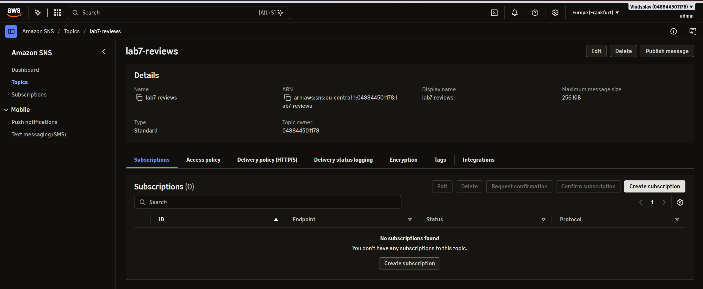

| Параметр | Значение | Обоснование |
|---|---|---|
| Visibility timeout | 30 с | 6 × таймаут Lambda (5 с), запас для обработки |
| Retention основной очереди | 4 дня | Хранение при временной недоступности |
| Retention DLQ | 14 дней | Время для диагностики и восстановления |
| Maximum receives | 5 | Повторные попытки при временных ошибках |
| Receive message wait time | 20 с | Long polling уменьшает пустые запросы |
| Delivery delay | 0 с | Без искусственной задержки |
| Encryption | SSE-SQS | Шифрование сообщений в очереди |

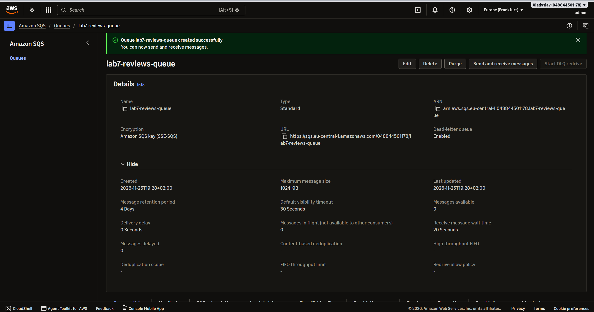

Через AWS CLI опубликован отзыв `r-1` с рейтингом 5. Получение проверено через SQS и CLI; без удаления сообщение снова становится доступным после истечения visibility timeout.

**Ответы:** Raw message delivery передаёт исходный JSON, а без него SNS добавляет обёртку с метаданными, включая `Message`. Получение сообщения не равнозначно его удалению: при отсутствии DeleteMessage после таймаута оно доступно повторно. Слишком короткий visibility timeout приводит к повторной доставке во время обработки, слишком длинный замедляет повторные попытки.

### Задание 2. Обработчик отзывов

Создана Python Lambda `lab7-review-worker` с IAM-ролью `lab7-review-worker-role` и политикой `AWSLambdaSQSQueueExecutionRole`. Настройки: 128 МБ памяти, timeout 5 с, batch size 10, batch window 0 с.

Обработчик десериализует `record["body"]`, извлекает идентификатор, рейтинг и первые 20 символов текста, затем записывает их в CloudWatch.

```python
for record in event["Records"]:
    review = json.loads(record["body"])
    print(f'{review["id"]}: {review["rating"]}/5 {review["text"][:20]}')
```

Три новых отзыва `r-2-1`, `r-2-2`, `r-2-3` обработаны тремя отдельными вызовами; оставшийся отзыв `r-1` обработан ещё одним вызовом. Один log stream содержал четыре разных RequestId. Размер пачки задаёт максимум, а не обязательное число сообщений: фактическое количество зависит от поступления сообщений и опроса очереди.

### Задание 3. Некорректный отзыв и DLQ

Отправлен отзыв `{"id":"r-4","rating":4}` без поля `text`. Обработчик завершался с `KeyError`, сообщение повторно доставлялось и после исчерпания настроенного лимита пяти получений попало в DLQ.

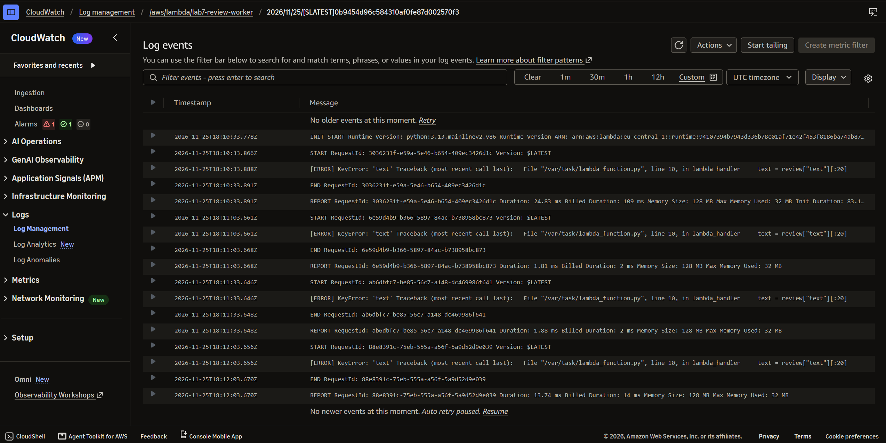

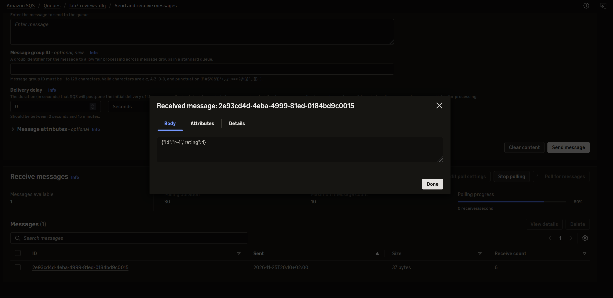

Обработчик исправлен заменой `review["text"]` на `review.get("text", "")`. Выполнен DLQ redrive в исходную очередь; после обработки сообщение исчезло из DLQ.

**Ответы:** число получений ограничено `maxReceiveCount=5`; между попытками действует visibility timeout. При ошибке одного элемента пачки и выключенном Report batch item failures вся пачка может быть доставлена повторно, включая уже обработанные элементы. DLQ позволяет восстановить сообщения после устранения причины сбоя.

### Задание 4. Фильтрация плохих отзывов

Создана подтверждённая Email-подписка SNS с фильтром по атрибутам сообщения:

```json
{"rating":[1,2]}
```

| Отзыв | Почта | Журнал worker |
|---|---|---|
| rating = 1 | Да | Да |
| rating = 3 | Нет | Да |
| rating = 5 | Нет | Да |
| Без атрибута rating | Нет | Да |

Таблица отражает ожидаемую маршрутизацию настроенной политики; письмо с рейтингом 1 подтверждено скриншотом.

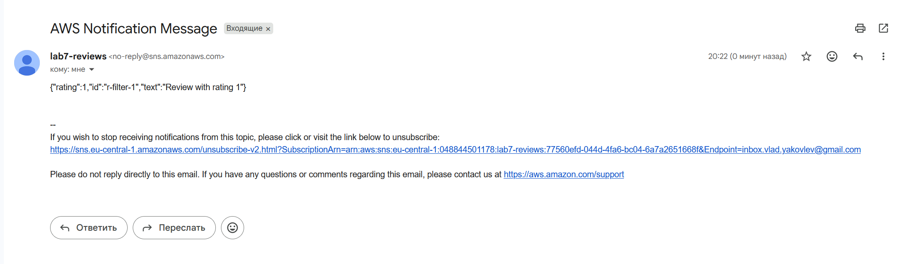

**Ответы:** SNS фильтрует атрибуты, поэтому наличие рейтинга только в теле не удовлетворяет условию. При прямой отправке в несколько очередей издателю пришлось бы знать каждого получателя и изменять код при добавлении отдела аналитики; SNS позволяет добавить подписку без изменения издателя.

Временные ресурсы части 1 больше не используются; перед завершением необходимо проверить отсутствие ресурсов `lab7-*`.

## Часть 2. TimeCapsule

### Архитектура приложения

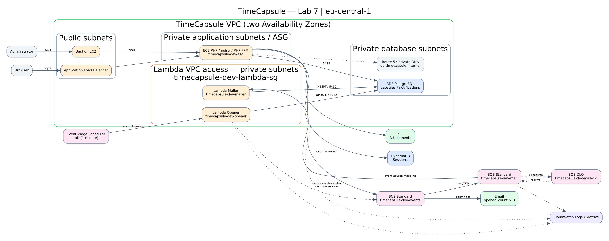

Сохранены ALB, Auto Scaling, RDS, S3, DynamoDB, VPC и Bastion. Добавлены управляемые событийные компоненты. Схема отражает логическую архитектуру, а не точную топологию всех сетевых ресурсов.

### Задание 5. Очередь писем и событие о запечатывании

Созданы `timecapsule-dev-events` (SNS Standard), `timecapsule-dev-mail` и `timecapsule-dev-mail-dlq` (SQS Standard). Подписка SQS использует Raw message delivery. Первоначально созданная FIFO-тема заменена на Standard для совместимости с выбранной схемой подписок и публикации.

| Параметр | Значение | Обоснование |
|---|---|---|
| Visibility timeout | 180 с | 6 × timeout Mailer (30 с) |
| Retention | 4 дня | Сохранение событий при временном сбое |
| DLQ retention | 14 дней | Диагностика и redrive |
| Maximum receives | 5 | Ограниченное число повторов |
| Wait time | 20 с | Long polling |

Контракт `capsule.sealed` содержит `version`, `type`, `event_id`, `capsule_id`. Получатель, название и дата открытия загружаются из PostgreSQL. В событии не передаются содержимое капсулы, вложения, email и секреты. Подробности: [events.md](events.md).

### Задание 6. Lambda Mailer

Создана функция `timecapsule-dev-mailer` (Python 3.13, pg8000, ZIP). Роль `timecapsule-dev-mailer-role` использует `AWSLambdaSQSQueueExecutionRole` и `AWSLambdaVPCAccessExecutionRole`. Функция подключена к приватным подсетям VPC и `timecapsule-dev-lambda-sg`; RDS разрешает TCP 5432 от этой группы. TLS проверяется по RDS CA bundle и оригинальному endpoint. Ключи AWS в коде не используются.

Настройки: память 128 МБ, timeout 30 с, batch size 1, batch window 0 с, maximum concurrency 2 на уровне SQS mapping. Reserved concurrency не удалось установить из-за ограничения квоты аккаунта; выбран лимит источника событий. Batch size 1 изолирует ошибки отдельных сообщений, а лимит 2 ограничивает число одновременных подключений Mailer к RDS.

Для идемпотентности обновлена действующая БД и файл `database/schema.sql`:

```sql
ALTER TABLE notifications ADD COLUMN IF NOT EXISTS event_id VARCHAR(255);
CREATE UNIQUE INDEX IF NOT EXISTS notifications_event_id_idx ON notifications (event_id);
```

Mailer выполняет вставку с `ON CONFLICT (event_id) DO NOTHING`. Два одинаковых сообщения отправлены напрямую в SQS: в логах зафиксировано создание уведомления и игнорирование дубликата. Проверка PostgreSQL подтвердила одну запись по идентификатору события. Дубликат может повторно выполнить часть работы, но не создаёт вторую строку.

### Задание 7. Публикация событий из PHP

В ветке lab7 добавлен `EventPublisher` на базе AWS SDK for PHP. `CapsuleController` публикует событие после сохранения капсулы вместо синхронного вызова Mailer. `App.php` создаёт publisher через constructor injection; ARN задаётся переменной `SNS_TOPIC_ARN`. Роль EC2 `timecapsule-dev-app-role` получила политику `timecapsule-dev-app-events` с `sns:Publish` для конкретной темы.

Доступ к SNS проверен с EC2 через HTTPS. Создан AMI `timecapsule-dev-ami-lab7-v1`, обновлён Launch Template, выполнен Instance Refresh для ASG.

**До изменений:** POST `/capsules`, HTTP 302, Waiting = 3,25 с.

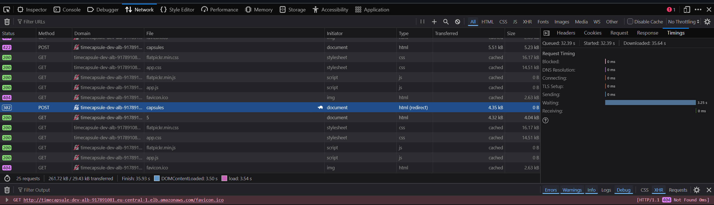

**После изменений:** POST `/capsules`, HTTP 302, Waiting = 299 мс.

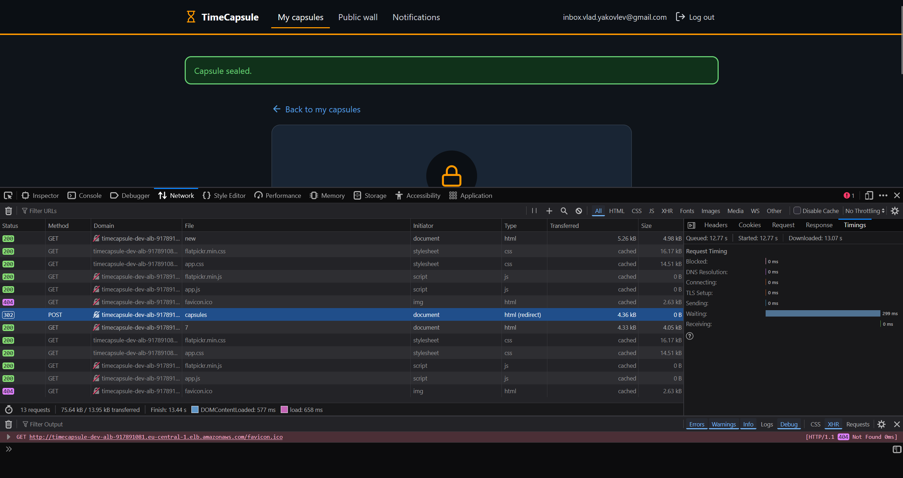

| Показатель | До | После |
|---|---:|---:|
| Waiting (Network / Timings) | 3250 мс | 299 мс |
| Сокращение | — | 2951 мс |

В данном эксперименте время ожидания уменьшилось примерно на 90,8% (в 10,9 раза). Это два отдельных измерения, а не статистический нагрузочный тест.

**Ответ:** если Mailer сломан, пользователь всё равно получает подтверждение запечатывания при успешной публикации SNS; уведомление ожидает обработки в SQS либо DLQ. Сбой самой публикации после сохранения капсулы остаётся отдельным риском.

### Задание 8. Открытие капсул по расписанию

Создана функция `timecapsule-dev-opener` с Python 3.13 и pg8000, подключённая к той же VPC и Lambda Security Group. IAM-роль `timecapsule-dev-opener-role` имеет права VPC и SNS Publish. Opener выполняет:

```sql
UPDATE capsules
SET opened_at = NOW() AT TIME ZONE 'UTC'
WHERE opened_at IS NULL
  AND open_at <= NOW() AT TIME ZONE 'UTC'
RETURNING id;
```

`opened_at IS NULL` предотвращает повторное открытие. Lambda возвращает список событий; On success Destination отправляет invocation record в SNS без прямого сетевого вызова из кода функции. Mailer расширен для обработки `responsePayload.events`.

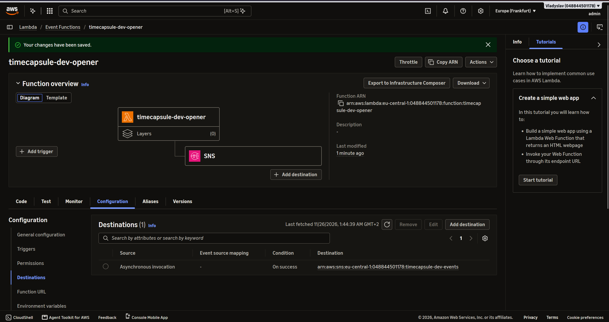

Создано расписание `timecapsule-dev-open-capsules` с `rate(1 minute)`, Flexible time window Off, отдельной ролью `timecapsule-dev-opener-scheduler-role`. Существующая роль расписания RDS не изменялась.

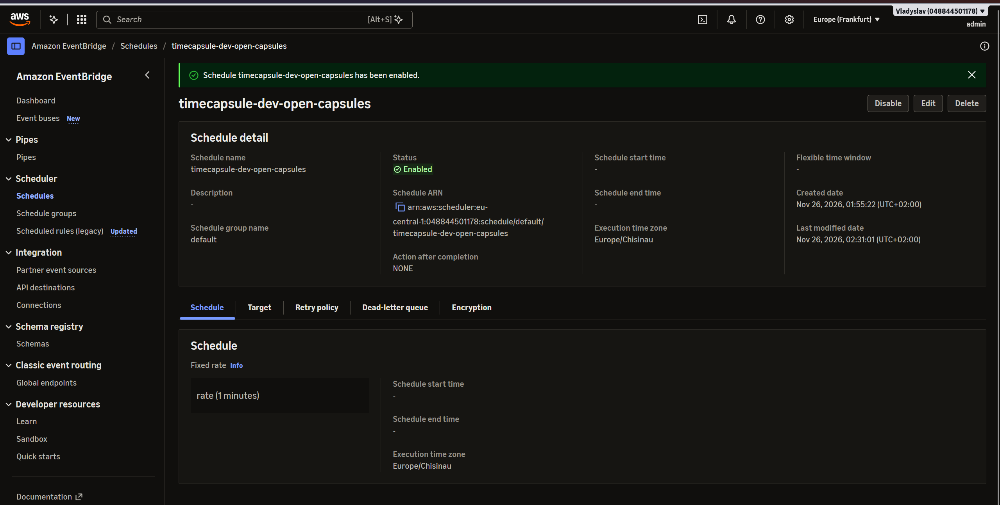

Из `App.php` удалён вызов `CapsuleOpener::openDue()` при веб-запросах. Развёрнут AMI `timecapsule-dev-ami-lab7-v2` через новую версию Launch Template и Instance Refresh.

Email-подписка фильтрует тело сообщения по `responsePayload.type = capsule.opened` и `opened_count > 0`. Подписка SQS оставлена без фильтра: пустые результаты не создают уведомлений, но вызывают лишние обращения к Mailer.

Эксперимент: создана капсула с открытием через несколько минут, сайт закрыт. CloudWatch подтвердил `Opened capsules: 1`, затем получено письмо SNS и проверены уведомления в приложении.

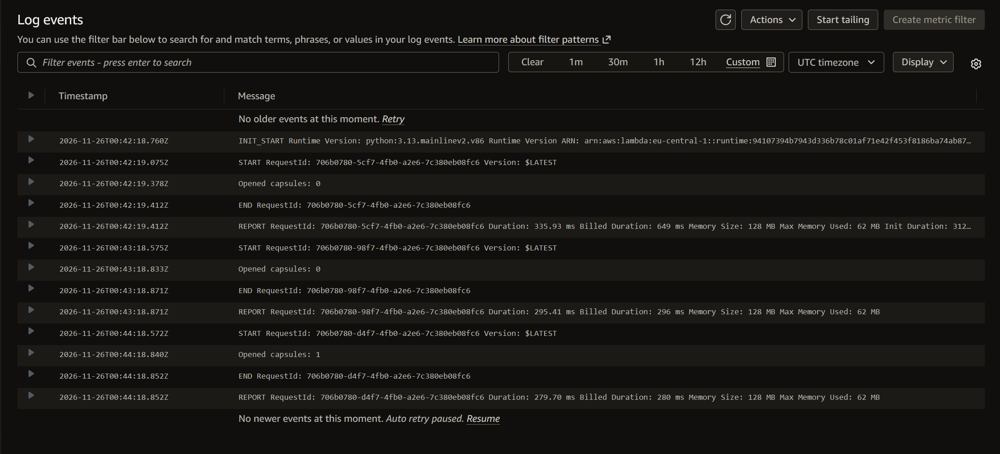

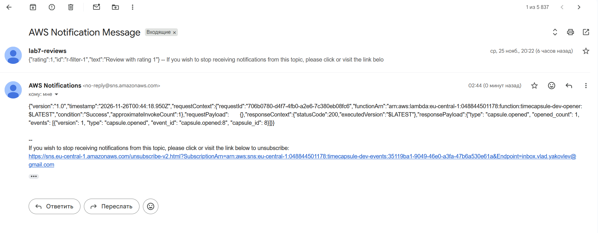

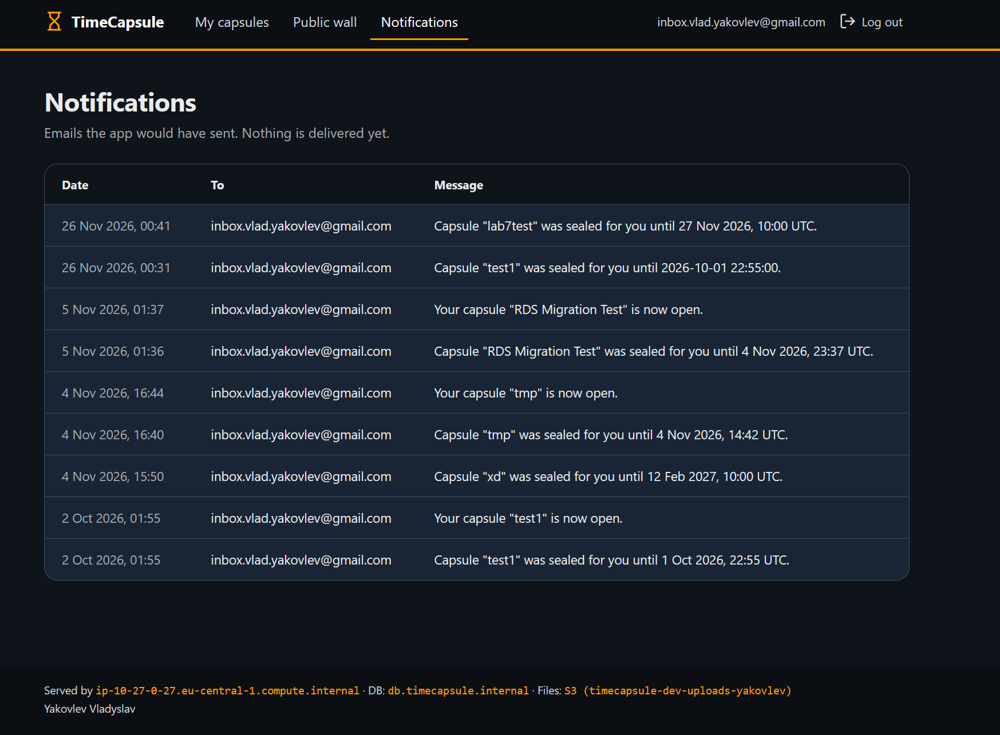

**Ответы:** при сбое Destination после коммита открытие сохраняется, но уведомление может потеряться. Для прямой публикации из Lambda в приватной подсети потребовался бы NAT Gateway либо интерфейсный VPC endpoint SNS; оба могут иметь почасовую плату и оплату трафика, конкретная цена зависит от конфигурации и региона. Расписание добавляет задержку до следующего запуска (при нормальной работе порядка минуты), зато открытие не зависит от посещений сайта. Формат результата описан в [events.md](events.md).

### Задание 9. Сбой обработчика

Расписание Opener временно отключено. В Mailer задан неверный пароль PostgreSQL, после чего созданы две тестовые капсулы. Веб-приложение продолжило работать, а сообщения остались в очереди для повторной обработки.

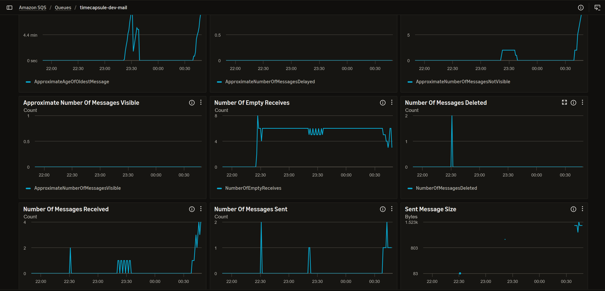

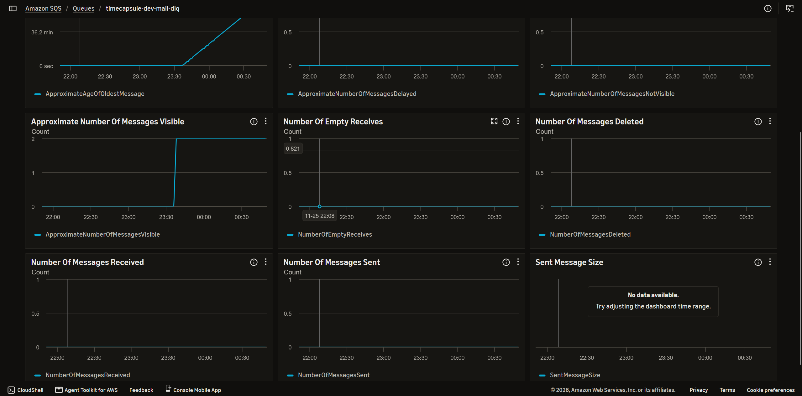

При `maxReceiveCount=5` и visibility timeout 180 с сообщения переходят в DLQ после исчерпания лимита получений; точное время зависит также от polling и backoff Lambda. Для восстановления предусмотрены возврат правильного пароля, DLQ redrive и проверка одного уведомления на каждую капсулу. Отдельный скриншот или SQL-вывод после redrive не предоставлен, поэтому результат восстановления следует подтвердить при защите.

**Ответ:** в ЛР6 ошибка синхронной отправки могла завершить веб-запрос ошибкой после сохранения капсулы, а очереди для повторной обработки не было. В новой архитектуре доставленные в SQS сообщения можно восстановить из DLQ в пределах срока хранения.

### Задание 10. Архитектурное решение

Подготовлены [обновлённая архитектура](architecture.png) и [ADR-0006](0006-background-jobs.md). Сравнены выполнение внутри HTTP-запроса, cron на EC2 и Lambda с SNS/SQS. Выбран последний вариант для независимости фоновой работы от веб-сервера и возможности повторной обработки.

## Контрольные вопросы

**1. Как проходит событие от Seal capsule до notifications? Где оно может задержаться или потеряться?**

PHP сохраняет капсулу в RDS и публикует `capsule.sealed` в SNS, который передаёт событие в SQS. Mailer получает сообщение, читает данные капсулы и записывает уведомление с уникальным `event_id`. Задержки возможны в очереди, при повторных попытках и при недоступности базы; потеря возможна между коммитом и публикацией, при сбое доставки либо после истечения срока хранения.

**2. Чем SQS отличается от SNS?**

SNS — механизм публикации и рассылки одного события нескольким подписчикам, включая фильтрацию. SQS хранит сообщения до обработки и обеспечивает повторную доставку и DLQ. Вместе они разделяют издателя и обработчики, предоставляя буфер на время сбоев.

**3. Почему Lambda в VPC не нужен интернет для SQS и Destination?**

Сама служба Lambda опрашивает SQS через event source mapping и доставляет результаты асинхронных вызовов в SNS через Destination. Код функций обращается только к PostgreSQL по приватной сети VPC; поэтому для этих операций NAT Gateway не требуется. IAM-роли предоставляют необходимые разрешения.

**4. Как изменилась архитектура относительно ЛР2?**

От размещения приложения на EC2 архитектура перешла к управляемым сервисам хранения, балансировки, масштабирования и событийной обработки. AWS обеспечивает хранение очередей, запуск Lambda, доставку событий и планирование. Разработчик отвечает за код, контракты, IAM, сетевую конфигурацию, идемпотентность, мониторинг и обработку сбоев.

## Завершение работы

После экспериментов необходимо отключить расписание Opener и триггер SQS Mailer, остановить RDS, уменьшить Min и Desired capacity ASG до 0 и остановить Bastion. До защиты постоянные ресурсы сохраняются. После защиты при отсутствии ЛР8 ресурсы удаляются и проверяются расходы в Billing and Cost Management.

## Вывод

Реализована событийная архитектура TimeCapsule с SNS, SQS, Lambda и EventBridge Scheduler. Перенос уведомлений из веб-запроса снизил измеренное время ожидания ответа с 3,25 с до 299 мс. Открытие капсул стало независимым от посещений сайта, а уникальный индекс и DLQ обеспечили защиту от дублирования уведомлений и возможность восстановления сообщений после сбоев.
